<div align="center">


# Zhiro · 职路

**A job-search assistant that runs on your own computer**

Find jobs, look into companies, keep track of applications.
Works with AI assistants such as Claude Code and Codex.

English | [简体中文](README.zh-CN.md)

[](https://github.com/mazjq/zhiro/actions/workflows/ci.yml)
[](https://www.npmjs.com/package/@mazjq/zhiro)
[](LICENSE)

[Why Zhiro](#why-zhiro) · [What it does](#what-it-does) · [Install](#install) · [Connect your AI assistant](#connect-your-ai-assistant) · [Your data](#your-data) · [Documentation](#documentation)

</div>

Every day Zhiro collects jobs from companies' recruiting sites, picks the ones that fit your degree, major and
experience, and reminds you which ones close soon. It can look up listed companies' financial reports and
announcements to help you decide whether a company is worth joining. After you apply, it can also keep track of your
progress, read interview emails and fill in application forms.

It is built mainly for campus recruiting in China (校招), and works for other job searches too.

<p align="center">
  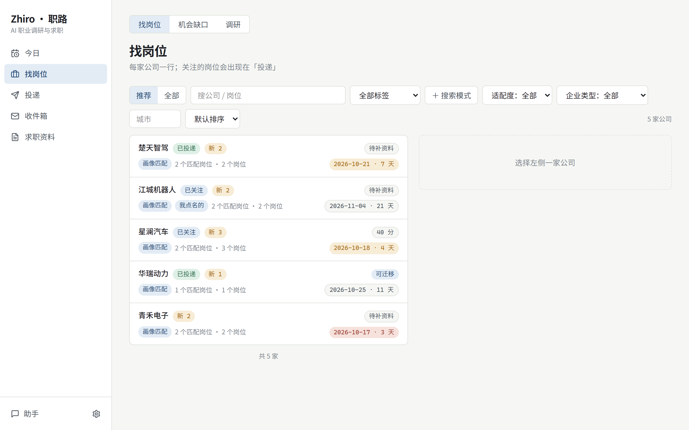<br>
  <sub>Every company, job and number in the screenshots is made up.</sub>
</p>

## Why Zhiro

<table>
  <tr>
    <td width="33%" valign="top"><b><a href="#1-know-what-to-learn-next">1. Know what to learn next</a></b><br><br>Gathers what jobs ask for and lists the skills your profile doesn't mention yet.</td>
    <td width="33%" valign="top"><b><a href="#2-see-how-a-company-is-doing">2. See how a company is doing</a></b><br><br>Listed companies' financials, pay and announcements, and industry reports written by your AI assistant.</td>
    <td width="33%" valign="top"><b><a href="#3-dont-miss-a-job-or-a-deadline">3. Don't miss a job or a deadline</a></b><br><br>Reads the recruiting sites you subscribe to every day; a brief every morning, a list every Monday.</td>
  </tr>
  <tr>
    <td valign="top"><b><a href="#4-fills-in-application-forms">4. Fills in application forms</a></b><br><br>Uploads your resume, fills the form from your profile, then stops for you to check and submit.</td>
    <td valign="top"><b><a href="#5-after-you-apply">5. After you apply</a></b><br><br>Keeps track of each application and recognises test and interview invitations in your mail.</td>
    <td valign="top"><b><a href="#6-the-important-things-reach-your-phone">6. The important things reach your phone</a></b><br><br>The brief, test and interview times, and jobs about to close, sent to you through Feishu.</td>
  </tr>
  <tr>
    <td colspan="3" valign="top"><b><a href="#7-your-data-stays-safe">7. Your data stays safe</a></b><br><br>Everything is kept on your own computer, and an AI assistant waits for your confirmation before anything important.</td>
  </tr>
</table>

### 1. Know what to learn next

Zhiro gathers the requirements of the jobs related to your field, lists the skills your profile doesn't mention yet,
and counts how many jobs and companies ask for each one. In the screenshot below, C++ is required by 4 jobs and ROS by 2.

If you already have a skill, click *I can do this* and it is added to your profile. If you don't, click *haven't done
this*. Job recommendations are recalculated from your answers.

<p align="center">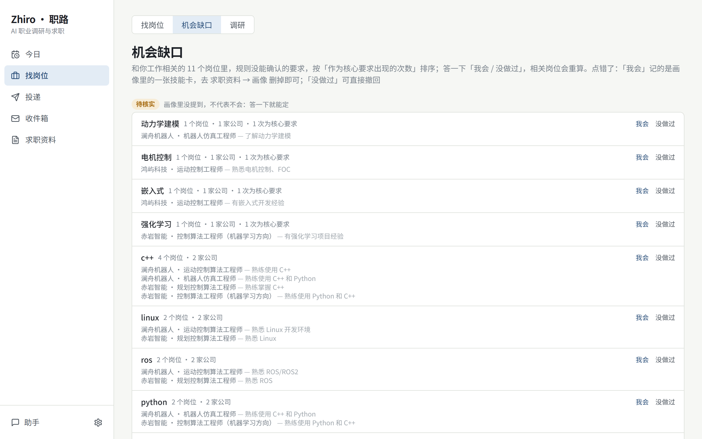</p>

### 2. See how a company is doing

For listed companies (A-shares, Hong Kong, US, NEEQ), Zhiro can look up:

- three years of revenue, profit, growth, gross margin and R&D spending;
- headcount, and the average cash the company pays per employee (salary, social insurance and so on);
- the past year's announcements, such as employee share plans or equity incentives, new production lines, government
  grants, being named a "专精特新" company (usually a niche firm that is hard to replace in its industry), and share
  sales by major shareholders.

You can also ask your AI assistant to research a whole industry. It writes a report from this data, broker research
and what it finds online. Every point names its source, and the numbers it quotes are checked against the original
data. If a company in the report is hiring, you can click through to its jobs.

<p align="center">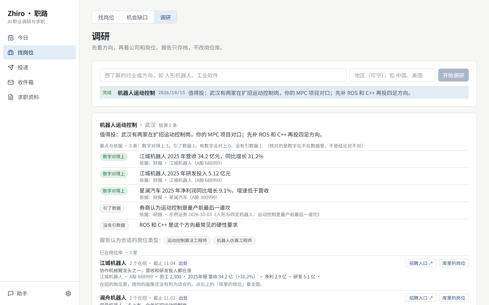</p>

<p align="center">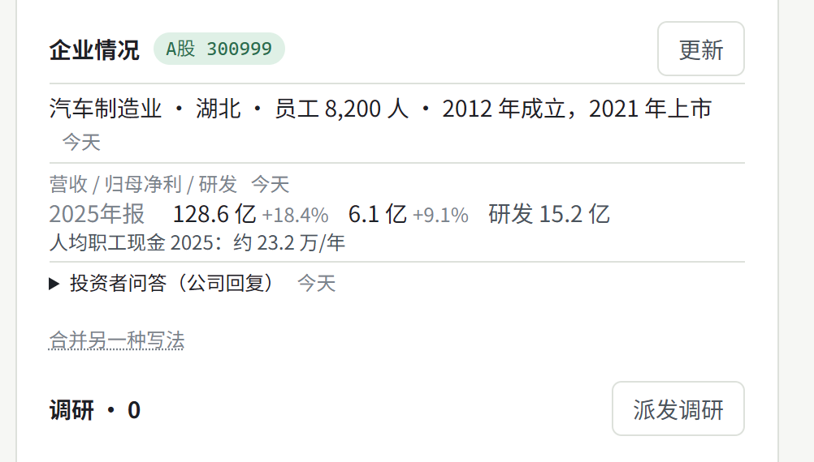</p>

### 3. Don't miss a job or a deadline

Every day Zhiro reads the recruiting sites you subscribe to: companies' own hiring systems (Moka, Beisen, Feishu Jobs,
51job, Zhaopin, iGuopin and more) and 高校人才网 (gaoxiaojob.com, where research institutes, labs, university teams and
public institutions post). It can also read spreadsheets you keep yourself (Feishu Base, CSV files).

The same job sometimes shows different deadlines on different sites. Zhiro compares them and notes which site each
date came from and whether it has been verified.

**A brief every morning.** Jobs that close today or soon and that you have not applied to, and the tests and
interviews you have been given, all in one place. It also tells you which new jobs fit you.

**A list every Monday.** From the week's new jobs Zhiro picks about ten worth a look; you click apply, skip or hold.
When you skip you can say why, for example “not this city”, and jobs like it stop appearing.

**Mark the companies you want.** You can mark one before it starts hiring, and Zhiro tells you as soon as it posts a
job.

**Internships too.** Zhiro collects internship postings by itself and recommends the ones that suit you first.

Your education, skills, projects and preferred cities are kept in your profile. Job recommendations, choosing a
resume and filling in forms all take their information from there.

| Today: jobs closing soon, things waiting for you | Profile: your education, skills and experience |
|---|---|
| 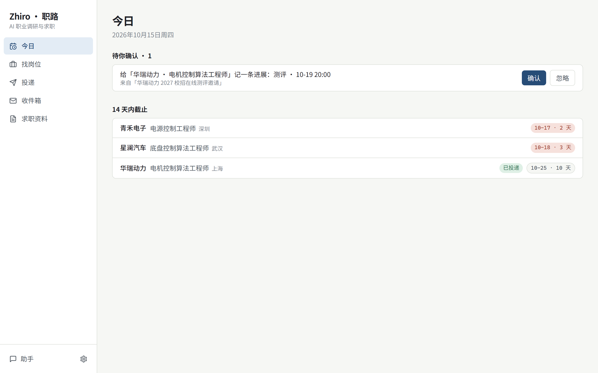 | 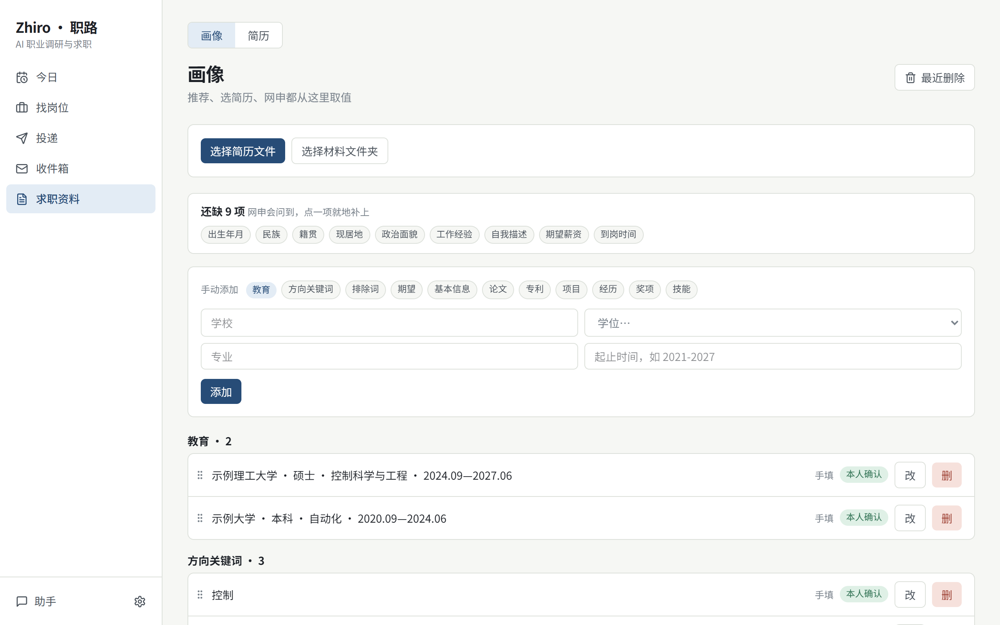 |

### 4. Fills in application forms

Every company's application form asks for your education, experience and awards all over again. Hand it to Zhiro and
this is what it does:

- Opens a separate Chrome window on the job's application page. Where a site needs a login, you sign in once and it is
  remembered.
- Uploads the resume you chose for this job. Some sites read the resume and fill part of the form themselves; Zhiro
  waits for that to finish, then fills what is still empty.
- Fills in your basic details, education, internships, projects and awards from your profile, entry by entry. It also
  picks from dropdowns, date pickers, and school and city lists.
- Leaves sensitive fields such as your ID number, and anything about family members, to you.
- Stops when it is done and tells you how many fields it filled, which ones it could not fill, and which ones are
  yours to write. You check the form and press *Submit* yourself. Zhiro never submits for you.

What you add to a form yourself, such as your political affiliation, is saved to your profile, so the next form does
not ask you again.

Moka, Beisen and Feishu Jobs, the hiring systems you meet most often, have dedicated support. Other sites are filled
in a general way, and how much gets filled depends on the site.

### 5. After you apply

Zhiro records where each application stands (preparing, applied, written test, interview, result) and reminds you as
dates come up.

Once you connect your mailbox, Zhiro reads recruiting emails, recognises test and interview invitations, finds the
application each one belongs to, and asks whether to update it.

| Applications: the progress and requirements of each one | Inbox: test and interview invitations found in your mail |
|---|---|
| 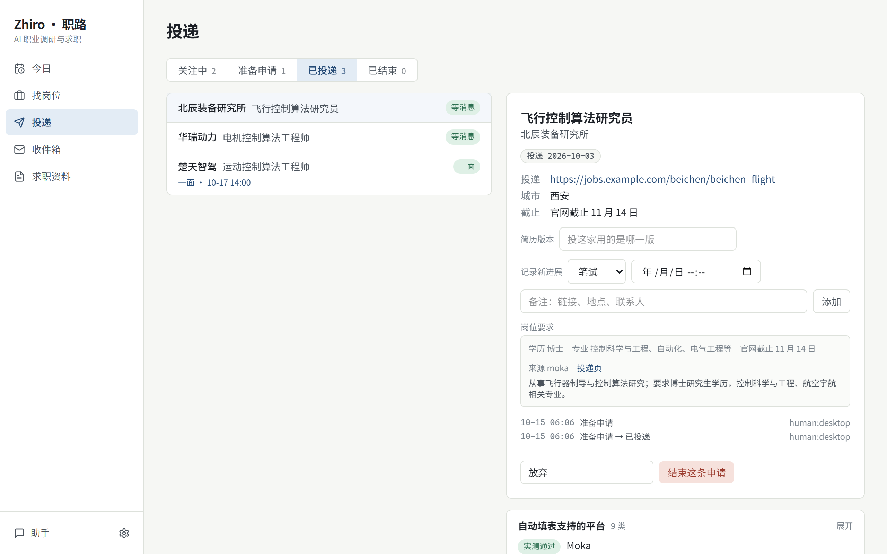 |  |

### 6. The important things reach your phone

Connect Feishu (Lark) and these come straight to your phone:

- the brief each morning
- the times of tests and interviews (once the day before, once shortly before they start)
- a job you meant to apply to that is about to close
- interview invitations, assessments, offers and rejections that arrive in your mailbox

A message counts as delivered once you have opened it. If a test or interview reminder stays unopened, Zhiro sends it
again as a Feishu urgent message, and then as a text message.

Connecting Feishu takes about ten minutes, once: [follow these steps](docs/feishu.md) (in Chinese).

<table align="center">
  <tr><th>The morning brief</th><th>A test, a deadline, an interview invitation</th></tr>
  <tr>
    <td valign="top">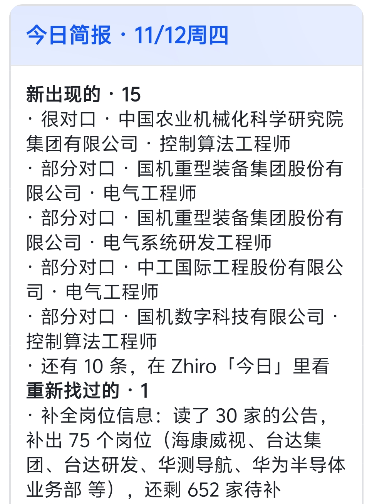</td>
    <td valign="top">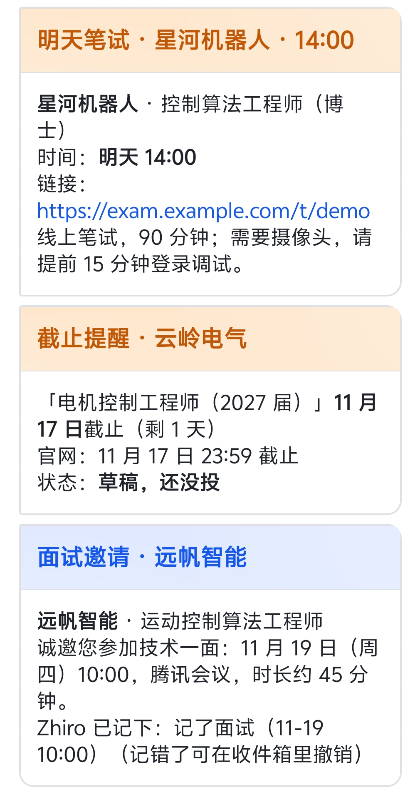</td>
  </tr>
</table>

<p align="center"><sub>The brief on the left is a real one; the companies, jobs and times in the three reminders on the right are made up.</sub></p>

### 7. Your data stays safe

An AI assistant can only directly do things that can be undone. Anything else waits until you click to confirm. It
never gets your logins for any site.

All your data is kept in one folder on your computer. Zhiro backs it up before every upgrade, and if an upgrade goes
wrong, one command restores it.

## What it does

✅ works today　🚧 being built　📌 planned (the order may change)

<details><summary><b>Show every feature</b></summary>

| | Feature | |
|---|---|---|
| **Finding jobs** | Reads the recruiting sites you subscribe to every day: Moka, Beisen, Feishu Jobs, 51job, Zhaopin, iGuopin, Dayee, 高校人才网 and more | ✅ |
| | Ranks jobs against your degree, major and experience | ✅ |
| | A brief every morning, a list every Monday | ✅ |
| | Internships: collected automatically, the ones that suit you recommended first | ✅ |
| | Companies you want: mark one before it starts hiring and hear as soon as it posts | ✅ |
| | Reads spreadsheets you keep yourself (Feishu Base, CSV) | ✅ |
| | The Monday list is chosen after an AI has read each job description, so it picks better | ✅ |
| | Jobs posted without a description get it filled in from the original page | 📌 |
| | More sources: small companies' own sites, university career sites, WeChat official accounts | 📌 |
| | A shared set of job data out of the box, so you need not subscribe site by site | 📌 |
| **Seeing the gap** | Collects what jobs ask for and lists the skills you lack, with how many jobs ask for each | ✅ |
| | Tells you which skill would open the most jobs and how you could pick it up | 📌 |
| **Knowing a company** | Listed companies: three years of financials, headcount and pay, a year of announcements | ✅ |
| | Industry research reports with a source for every conclusion | ✅ |
| | Several companies side by side | ✅ |
| **Deadlines** | The deadlines different sites give for the same job, compared | ✅ |
| | Reads the official announcement to check that a deadline is real | ✅ |
| **After you apply** | Keeps track of where each application stands | ✅ |
| | Fills in application forms, then stops for you to check and submit | ✅ |
| | Reads recruiting email, recognises tests, interviews, offers and rejections, and updates the application | ✅ |
| | Reminders on your phone through Feishu; the important ones are repeated until you have seen them | ✅ |
| **AI assistants** | Works with Claude Code, Codex, WorkBuddy and other assistants, by chatting | ✅ |
| | Chat with an AI inside Zhiro | ✅ |
| | Before using AI in the background it checks your allowance, and waits when it is running low | ✅ |
| **Your data** | Everything stays on your computer; backed up before each upgrade, restored with one command | ✅ |
| | A tray icon: start and stop with one click, see how it is running | 📌 |

</details>

## Install

Windows: search for "PowerShell" in the Start menu, open it, paste this line and press Enter:

```powershell
irm https://github.com/mazjq/zhiro/releases/latest/download/install.ps1 | iex
```

macOS / Linux: open Terminal, paste this line and press Enter:

```bash
curl -fsSL https://github.com/mazjq/zhiro/releases/latest/download/install.sh | sh
```

The first start asks where to keep your data (press Enter for the default), then opens Zhiro in your browser. Running
the same line again later upgrades it.

<details><summary>Already have Node.js 22.13 or newer</summary>

```bash
npx @mazjq/zhiro                 # try it
npm i -g @mazjq/zhiro && zhiro   # keep it; start it later by typing zhiro
```
</details>

<details><summary>Want to see what the install script does first</summary>

Download [`install.ps1`](https://github.com/mazjq/zhiro/releases/latest/download/install.ps1) or
[`install.sh`](https://github.com/mazjq/zhiro/releases/latest/download/install.sh) and read it before running it. The
script downloads an official copy of Node.js into Zhiro's own folder (checked against the checksums nodejs.org
publishes) and leaves the software already on your computer alone. When you upgrade, the previous version is kept.
</details>

To work on the code, see [CONTRIBUTING.md](CONTRIBUTING.md).

### Let an AI assistant install it

If you use an AI coding assistant such as Claude Code or Codex, send it this:

```text
Install Zhiro for me by following https://raw.githubusercontent.com/mazjq/zhiro/main/llms-install.md
(fetch it with curl, not a summarizer).
```

## Connect your AI assistant

You can use Zhiro in your browser without any AI assistant. Once you connect one, you can ask it in chat to find jobs,
research companies or fill in applications for you.

AI assistants use Zhiro through MCP (a common way for AI to call outside tools). Start Zhiro, then set it up once for
the assistant you use:

<details><summary>Claude Code</summary>

```bash
claude mcp add zhiro -- zhiro mcp            # Windows: claude mcp add zhiro -- cmd /c zhiro mcp
```
Or open Claude Code in the folder Zhiro prepares for it (shown on Zhiro's settings page); it is already set up there.
[More](docs/harness/claude-code.md)
</details>

<details><summary>Codex</summary>

```bash
codex mcp add zhiro --env ZHIRO_RESULT_MODE=text -- zhiro mcp
# Windows: codex mcp add zhiro --env ZHIRO_RESULT_MODE=text -- cmd /c zhiro mcp
# (ZHIRO_RESULT_MODE=text stops Codex receiving each result twice, which saves about half the usage)
```
[More](docs/harness/codex.md)
</details>

<details><summary>WorkBuddy, Cursor, and other MCP clients</summary>

[WorkBuddy](docs/harness/workbuddy.md) · [any MCP client](docs/harness/others.md)
</details>

Then just ask, for example: *"What closes this week?"*, *"Watch the control-algorithm jobs in Wuhan"*, *"Research the
humanoid robot industry"*, *"Fill in the application for the first job."*

### Use AI inside Zhiro

You can also use AI without leaving Zhiro. Pick who answers on the settings page (Claude Code, Codex, DeepSeek, or
Zhiro's built-in assistant), then click *Assistant* in the bottom-left corner to chat.

With Claude Code or Codex you pick the model from a list. Zhiro reads the list from the Claude Code and Codex installed
on your computer, newest first; if you don't pick one, it uses whatever you have set in them. The choice only applies
inside Zhiro and doesn't change their own settings.

The folder shown on the settings page is set up for your own AI assistant: open Claude Code or Codex there and there is
nothing else to configure. [More](docs/harness/embedded.md)

<p align="center">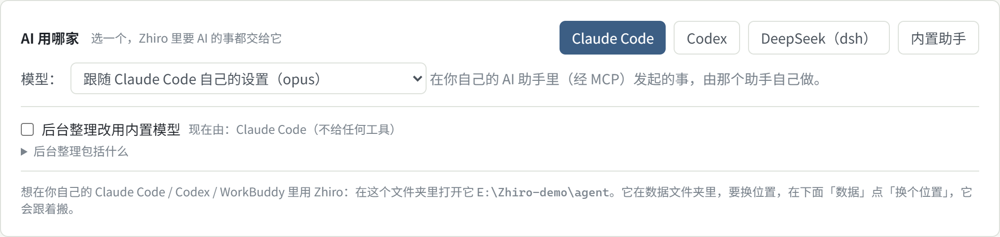</p>

With the built-in assistant, choose a model provider (DeepSeek, OpenAI, Anthropic and others) in the same card and sign
in or enter an API key.

<p align="center">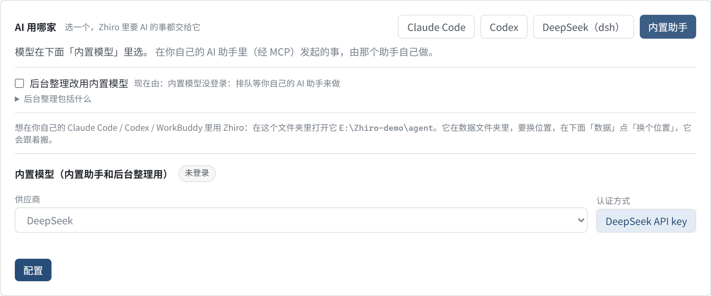</p>

## Your data

Everything is kept in one folder on your computer. By default that is `%APPDATA%\Zhiro\data` (Windows),
`~/Library/Application Support/Zhiro` (macOS) or `~/.local/share/zhiro` (Linux), or you can choose a folder at the first
start. Zhiro only connects to the recruiting sites you subscribe to and the AI assistant you choose.

```bash
zhiro vault verify      # check that the data is intact
zhiro vault backup      # make a backup now
zhiro vault rollback    # go back to before the last upgrade
```

More: [docs/data.md](docs/data.md) · Bring your own spreadsheet: [docs/data-sources.md](docs/data-sources.md)

## Documentation

| | |
|---|---|
| [docs/data.md](docs/data.md) | Where your data is; backup, upgrade, rollback, moving to another disk |
| [docs/data-sources.md](docs/data-sources.md) | Subscribe to your own sheet (Feishu Base, CSV) |
| [docs/feishu.md](docs/feishu.md) | Send the brief and reminders to Feishu on your phone |
| [docs/harness/](docs/harness/) | Claude Code, Codex, WorkBuddy, DeepSeek (dsh), other MCP clients |
| [docs/contrib/](docs/contrib/) | Architecture and design decisions, for contributors |

Most user docs are in Chinese for now; PRs translating them are welcome.

## Contributing

Bug reports, suggestions for recruiting sites to support, and pull requests are welcome. See
[CONTRIBUTING.md](CONTRIBUTING.md). Adding a recruiting site takes one file plus a test
([how](apps/daemon/src/data/readers/README.md)). Please report security issues privately ([SECURITY.md](SECURITY.md)).

## License

[MIT](LICENSE). The Moka reader includes three files from [career-ops](https://github.com/career-ops-hq/career-ops)
(MIT). The financial-report and announcement sources behind company profiles follow the public endpoints collected in
Simon Lin's [a-stock-data](https://github.com/simonlin1212/a-stock-data) (Apache-2.0).
