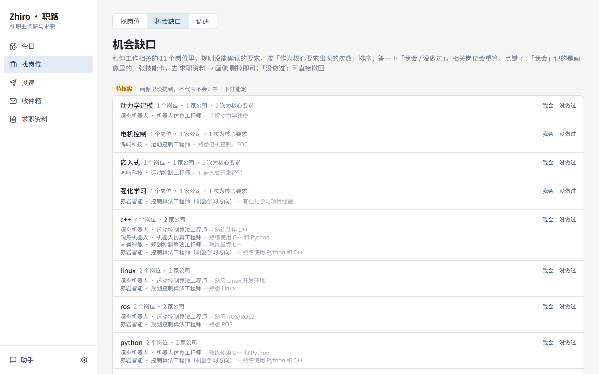
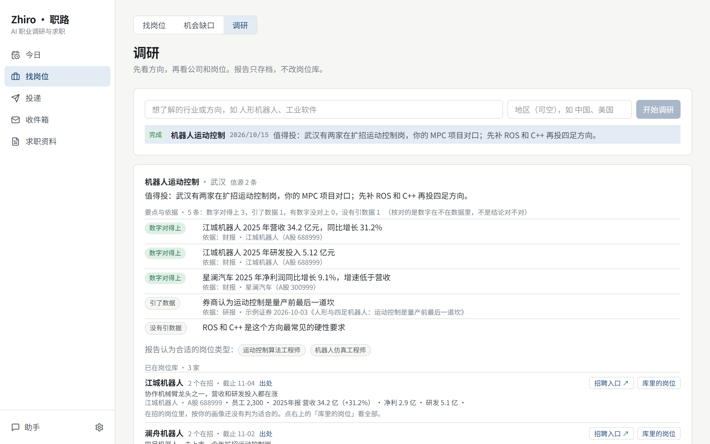
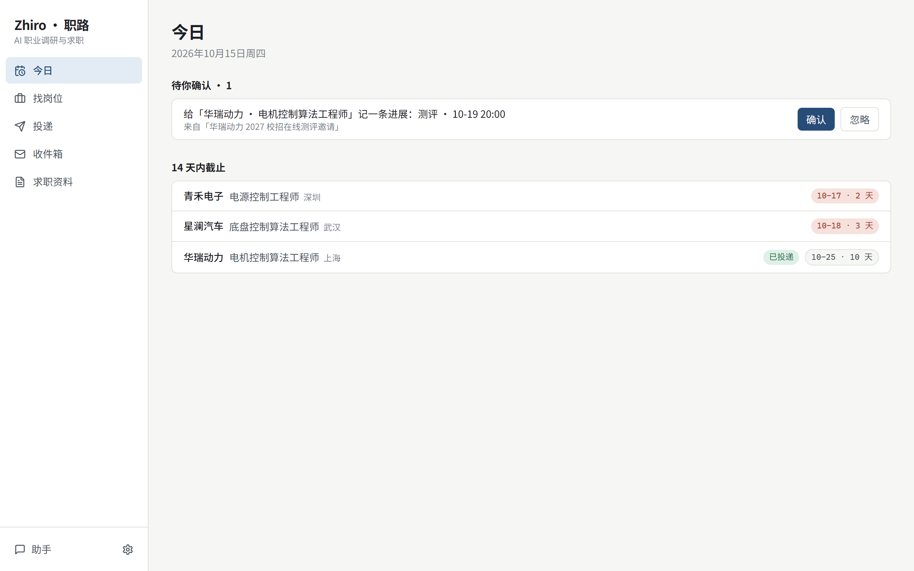
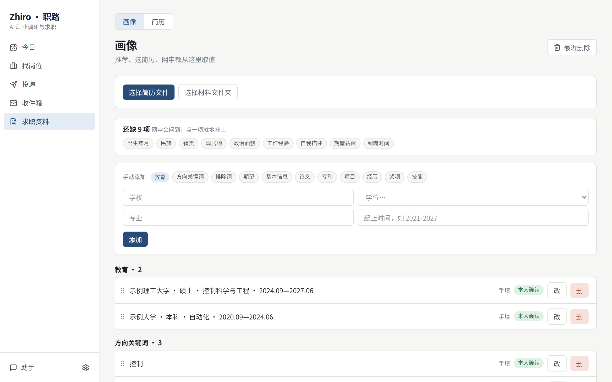
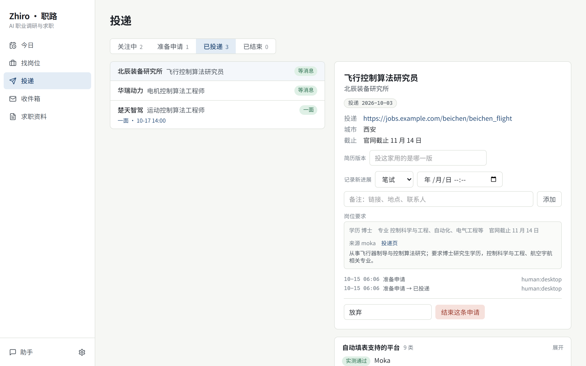
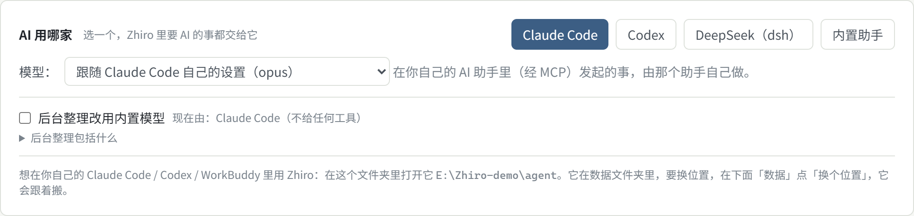

<div align="center">

# Zhiro · 职路

A job-search assistant that runs on your own computer: find jobs, look into companies, keep track of applications.
Works with AI assistants such as Claude Code and Codex.

English | [简体中文](README.zh-CN.md)

[](https://github.com/mazjq/zhiro/actions/workflows/ci.yml)
[](https://www.npmjs.com/package/@mazjq/zhiro)
[](LICENSE)

</div>

Every day Zhiro collects jobs from companies' recruiting sites, picks the ones that fit your degree, major and
experience, and reminds you which ones close soon. It can look up listed companies' financial reports and
announcements to help you decide whether a company is worth joining. After you apply, it can also keep track of your
progress, read interview emails and fill in application forms.

It is built mainly for campus recruiting in China (校招), and works for other job searches too.


<sub>Every company, job and number in the screenshots is made up.</sub>

## Why Zhiro

### 1. Know what to learn next

Zhiro gathers the requirements of the jobs related to your field, lists the skills your profile doesn't mention yet,
and counts how many jobs and companies ask for each one. In the screenshot below, C++ is required by 4 jobs and ROS by 2.

If you already have a skill, click *I can do this* and it is added to your profile. If you don't, click *haven't done
this*. Job recommendations are recalculated from your answers.



### 2. See how a company is doing

For listed companies (A-shares, Hong Kong, US, NEEQ), Zhiro can look up:

- three years of revenue, profit, growth, gross margin and R&D spending;
- headcount, and the average cash the company pays per employee (salary, social insurance and so on);
- the past year's announcements, such as employee share plans or equity incentives, new production lines, government
  grants, being named a "专精特新" company (usually a niche firm that is hard to replace in its industry), and share
  sales by major shareholders.

You can also ask your AI assistant to research a whole industry. It writes a report from this data, broker research
and what it finds online. Every point names its source, and the numbers it quotes are checked against the original
data. If a company in the report is hiring, you can click through to its jobs.




### 3. Don't miss a job or a deadline

Every day Zhiro reads the recruiting sites you subscribe to: companies' own hiring systems (Moka, Beisen, Feishu Jobs,
51job, Zhaopin, iGuopin and more) and 高校人才网 (gaoxiaojob.com, where research institutes, labs, university teams and
public institutions post). It can also read spreadsheets you keep yourself (Feishu Base, CSV files).

The same job sometimes shows different deadlines on different sites. Zhiro compares them and notes which site each
date came from and whether it has been verified.

Your education, skills, projects and preferred cities are kept in your profile. Job recommendations, choosing a
resume and filling in forms all take their information from there.

| Today: jobs closing soon, things waiting for you | Profile: your education, skills and experience |
|---|---|
|  |  |

### 4. After you apply

Zhiro records where each application stands (preparing, applied, written test, interview, result) and reminds you as
dates come up.

Once you connect your mailbox, Zhiro reads recruiting emails, recognises test and interview invitations, finds the
application each one belongs to, and asks whether to update it.

It can fill in application forms for you. It opens a separate Chrome window, fills the form from your profile and the
right resume, and then stops so you can check it and press *Submit* yourself.

| Applications: the progress and requirements of each one | Inbox: test and interview invitations found in your mail |
|---|---|
|  |  |

### 5. Your data stays safe

An AI assistant can only directly do things that can be undone. Anything else waits until you click to confirm. It
never gets your logins for any site.

All your data is kept in one folder on your computer. Zhiro backs it up before every upgrade, and if an upgrade goes
wrong, one command restores it.

## Install

Windows: search for "PowerShell" in the Start menu, open it, paste this line and press Enter:

```powershell
irm https://github.com/mazjq/zhiro/releases/latest/download/install.ps1 | iex
```

macOS / Linux: open Terminal, paste this line and press Enter:

```bash
curl -fsSL https://github.com/mazjq/zhiro/releases/latest/download/install.sh | sh
```

The first start asks where to keep your data (press Enter for the default), then opens Zhiro in your browser. Running
the same line again later upgrades it.

<details><summary>Already have Node.js 22.13 or newer</summary>

```bash
npx @mazjq/zhiro                 # try it
npm i -g @mazjq/zhiro && zhiro   # keep it; start it later by typing zhiro
```
</details>

<details><summary>Want to see what the install script does first</summary>

Download [`install.ps1`](https://github.com/mazjq/zhiro/releases/latest/download/install.ps1) or
[`install.sh`](https://github.com/mazjq/zhiro/releases/latest/download/install.sh) and read it before running it. The
script downloads an official copy of Node.js into Zhiro's own folder (checked against the checksums nodejs.org
publishes) and leaves the software already on your computer alone. When you upgrade, the previous version is kept.
</details>

To work on the code, see [CONTRIBUTING.md](CONTRIBUTING.md).

### Let an AI assistant install it

If you use an AI coding assistant such as Claude Code or Codex, send it this:

```text
Install Zhiro for me by following https://raw.githubusercontent.com/mazjq/zhiro/main/llms-install.md
(fetch it with curl, not a summarizer).
```

## Connect your AI assistant

You can use Zhiro in your browser without any AI assistant. Once you connect one, you can ask it in chat to find jobs,
research companies or fill in applications for you.

AI assistants use Zhiro through MCP (a common way for AI to call outside tools). Start Zhiro, then set it up once for
the assistant you use:

<details><summary>Claude Code</summary>

```bash
claude mcp add zhiro -- zhiro mcp            # Windows: claude mcp add zhiro -- cmd /c zhiro mcp
```
Or open Claude Code in the folder Zhiro prepares for it (shown on Zhiro's settings page); it is already set up there.
[More](docs/harness/claude-code.md)
</details>

<details><summary>Codex</summary>

```bash
codex mcp add zhiro --env ZHIRO_RESULT_MODE=text -- zhiro mcp
# Windows: codex mcp add zhiro --env ZHIRO_RESULT_MODE=text -- cmd /c zhiro mcp
# (ZHIRO_RESULT_MODE=text stops Codex receiving each result twice, which saves about half the usage)
```
[More](docs/harness/codex.md)
</details>

<details><summary>WorkBuddy, Cursor, and other MCP clients</summary>

[WorkBuddy](docs/harness/workbuddy.md) · [any MCP client](docs/harness/others.md)
</details>

Then just ask, for example: *"What closes this week?"*, *"Watch the control-algorithm jobs in Wuhan"*, *"Research the
humanoid robot industry"*, *"Fill in the application for the first job."*

### Use AI inside Zhiro

You can also use AI without leaving Zhiro. Pick who answers on the settings page (Claude Code, Codex, DeepSeek, or
Zhiro's built-in assistant), then click *Assistant* in the bottom-left corner to chat.

With Claude Code or Codex you pick the model from a list. Zhiro reads the list from the Claude Code and Codex installed
on your computer, newest first; if you don't pick one, it uses whatever you have set in them. The choice only applies
inside Zhiro and doesn't change their own settings.

The folder shown on the settings page is set up for your own AI assistant: open Claude Code or Codex there and there is
nothing else to configure. [More](docs/harness/embedded.md)



With the built-in assistant, choose a model provider (DeepSeek, OpenAI, Anthropic and others) in the same card and sign
in or enter an API key.


## Your data

Everything is kept in one folder on your computer. By default that is `%APPDATA%\Zhiro\data` (Windows),
`~/Library/Application Support/Zhiro` (macOS) or `~/.local/share/zhiro` (Linux), or you can choose a folder at the first
start. Zhiro only connects to the recruiting sites you subscribe to and the AI assistant you choose.

```bash
zhiro vault verify      # check that the data is intact
zhiro vault backup      # make a backup now
zhiro vault rollback    # go back to before the last upgrade
```

More: [docs/data.md](docs/data.md) · Bring your own spreadsheet: [docs/data-sources.md](docs/data-sources.md)

## Documentation

| | |
|---|---|
| [docs/data.md](docs/data.md) | Where your data is; backup, upgrade, rollback, moving to another disk |
| [docs/data-sources.md](docs/data-sources.md) | Subscribe to your own sheet (Feishu Base, CSV) |
| [docs/harness/](docs/harness/) | Claude Code, Codex, WorkBuddy, DeepSeek (dsh), other MCP clients |
| [docs/contrib/](docs/contrib/) | Architecture and design decisions, for contributors |

Most user docs are in Chinese for now; PRs translating them are welcome.

## Contributing

Bug reports, suggestions for recruiting sites to support, and pull requests are welcome. See
[CONTRIBUTING.md](CONTRIBUTING.md). Adding a recruiting site takes one file plus a test
([how](apps/daemon/src/data/readers/README.md)). Please report security issues privately ([SECURITY.md](SECURITY.md)).

## License

[MIT](LICENSE). The Moka reader includes three files from [career-ops](https://github.com/career-ops-hq/career-ops)
(MIT). The financial-report and announcement sources behind company profiles follow the public endpoints collected in
Simon Lin's [a-stock-data](https://github.com/simonlin1212/a-stock-data) (Apache-2.0). Reading BOSS 直聘 in a logged-in browser and taking only the job data the page itself loads follows
[boss-zhipin-scraper](https://github.com/eatmoreduck/boss-zhipin-scraper) (MIT); no code is taken from it.
