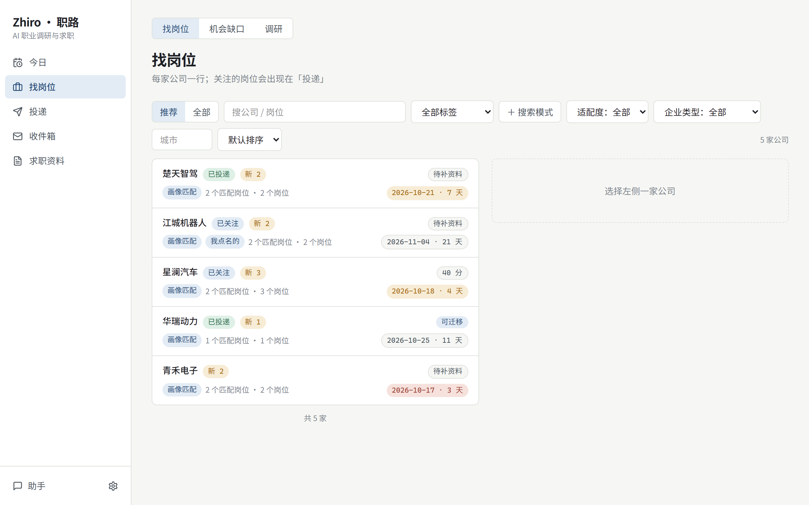
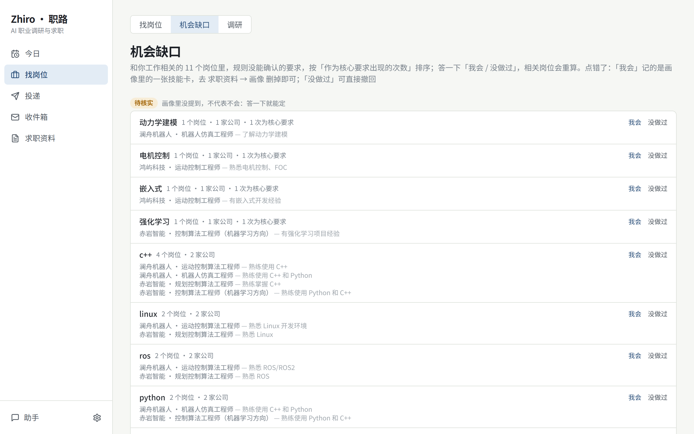
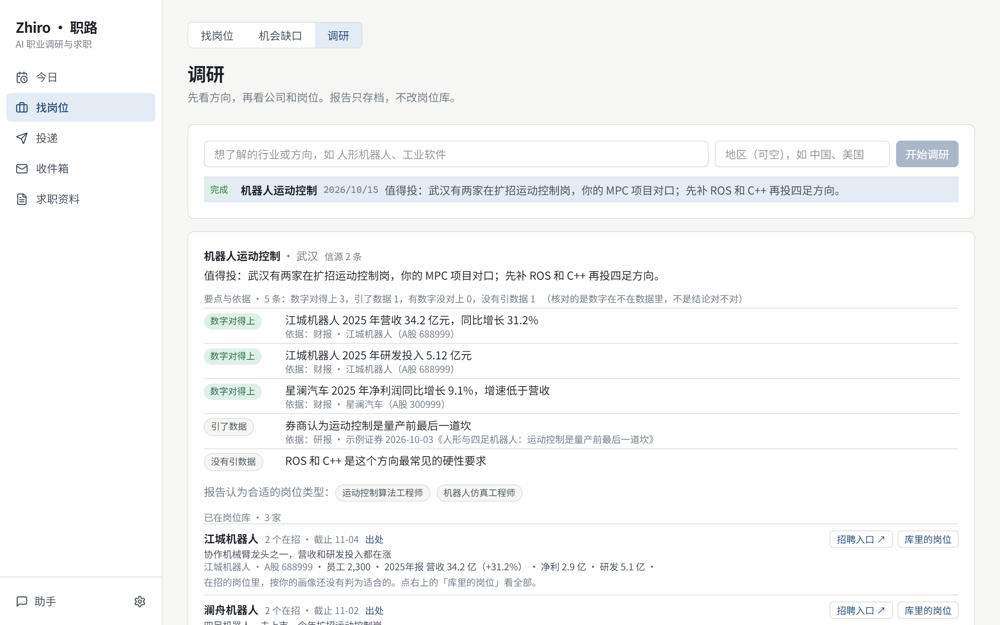
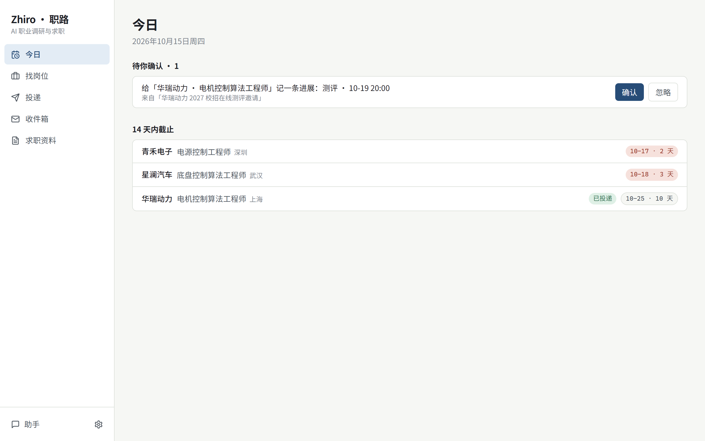
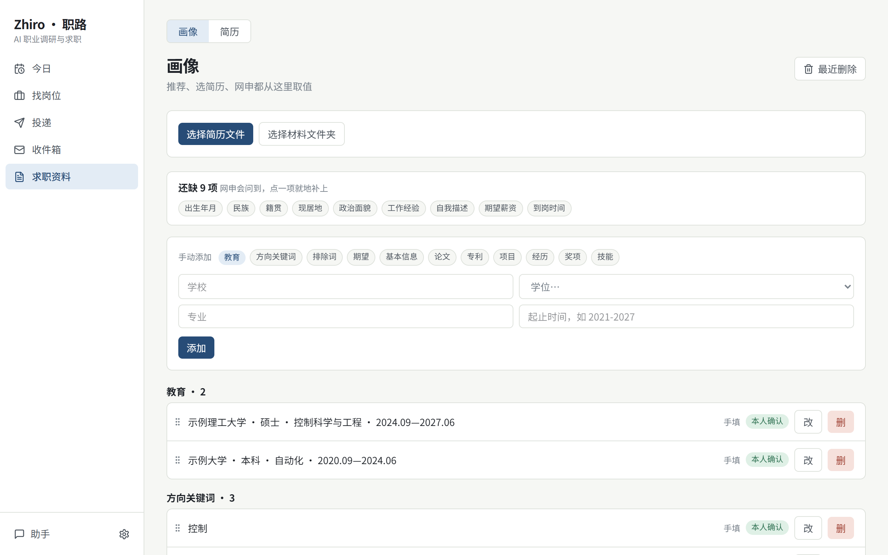
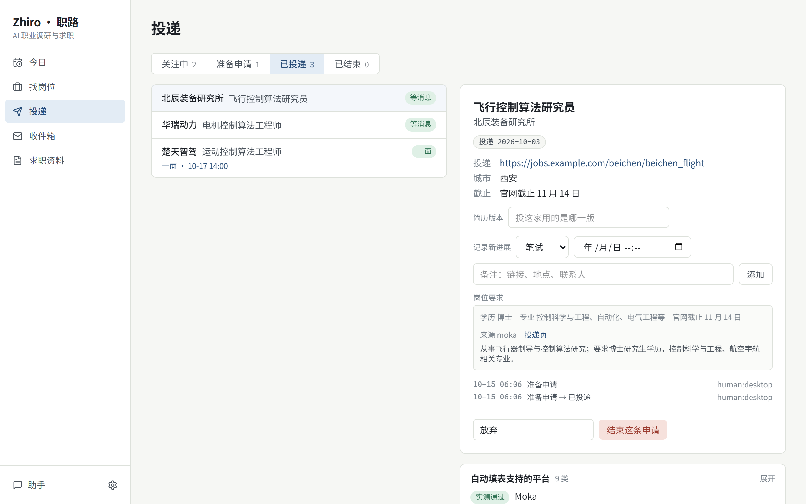
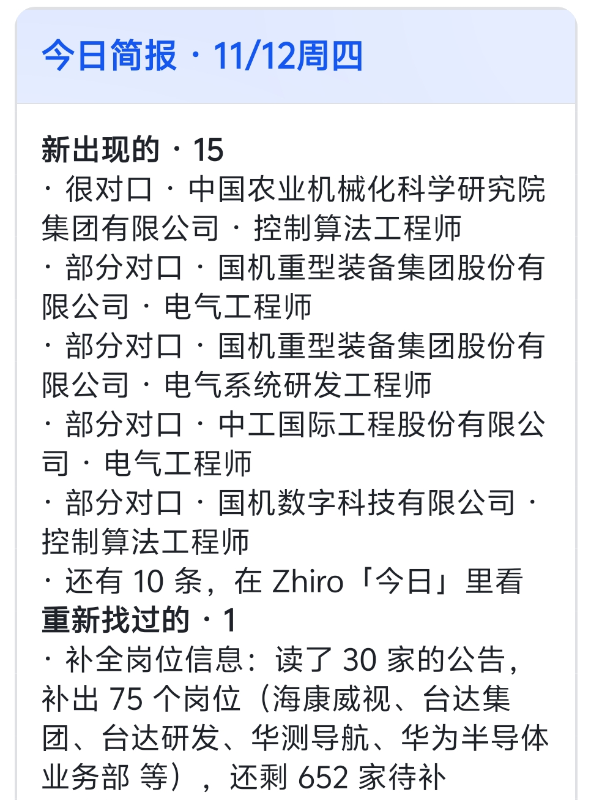
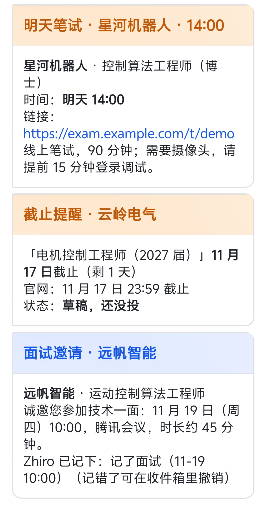

<div align="center">


# Zhiro · 职路

**在你自己电脑上运行的求职助手**

找岗位、了解公司、管理投递。可以配合 Claude Code、Codex 等 AI 助手使用。

[English](README.md) | 简体中文

[](https://github.com/mazjq/zhiro/actions/workflows/ci.yml)
[](https://www.npmjs.com/package/@mazjq/zhiro)
[](LICENSE)

[能做什么](#为什么用职路) · [功能一览](#功能一览) · [安装](#安装) · [接到 AI 助手](#接到你的-ai-助手) · [你的数据](#你的数据) · [文档](#文档)

</div>

职路每天从各公司的招聘网站收集岗位，按你的学历、专业和经历挑出合适的，并提醒你哪些快截止了。它能查上市公司的财报和公告，帮你判断一家公司值不值得去。投递以后的进度、面试邮件和网申表格，也可以交给它。

目前主要面向国内校招，社招也能用。

<p align="center">
  <br>
  <sub>截图里的公司、岗位和数字都是虚构的。</sub>
</p>

## 为什么用职路

<table>
  <tr>
    <td width="33%" valign="top"><b><a href="#1-知道自己该补什么">1. 知道自己该补什么</a></b><br><br>汇总岗位要求，列出你的资料里还没写到的技能。</td>
    <td width="33%" valign="top"><b><a href="#2-了解公司的经营情况">2. 了解公司的经营情况</a></b><br><br>上市公司的财报、员工薪酬和公告，还能让 AI 助手写行业调研报告。</td>
    <td width="33%" valign="top"><b><a href="#3-不错过岗位和截止日期">3. 不错过岗位和截止日期</a></b><br><br>每天去读你订阅的招聘网站，早上发简报，周一发清单。</td>
  </tr>
  <tr>
    <td valign="top"><b><a href="#4-帮你填网申表格">4. 帮你填网申表格</a></b><br><br>上传简历，按你的资料把表格填好，然后停下来等你检查、自己提交。</td>
    <td valign="top"><b><a href="#5-投递之后">5. 投递之后</a></b><br><br>记下每份申请的进度，从招聘邮件里认出笔试和面试通知。</td>
    <td valign="top"><b><a href="#6-重要的事发到手机">6. 重要的事发到手机</a></b><br><br>简报、笔试和面试时间、快截止的岗位，通过飞书发给你。</td>
  </tr>
  <tr>
    <td colspan="3" valign="top"><b><a href="#7-数据安全">7. 数据安全</a></b><br><br>数据都存在你自己的电脑上，AI 助手做重要的操作前要你点确认。</td>
  </tr>
</table>

### 1. 知道自己该补什么

职路会把和你方向相关的岗位要求汇总起来，列出你的资料里还没写到的技能，并算出每一项出现在多少个岗位、多少家公司的要求里。比如下图中，C++ 出现在 4 个岗位的要求里，ROS 出现在 2 个。

其实会的，点「我会」，它会记进你的资料；没学过的点「没做过」。岗位推荐会按你的回答重新算一遍。

<p align="center"></p>

### 2. 了解公司的经营情况

对上市公司（A 股、港股、美股、新三板），职路能查到：

- 近三年的营收、利润、增长率、毛利率和研发投入；
- 员工人数，以及公司平均为每位员工支付的现金（工资、社保等）；
- 近一年的公告，比如员工持股或股权激励、扩建产线、获得政府补助、被认定为「专精特新」企业（一般是某个细分领域里很难被替代的公司）、大股东减持。

你也可以让 AI 助手调研一个行业。它会结合这些数据、券商研报和网上的资料写一份报告，每条结论注明出处，引用的数字会自动和原始数据核对一遍。报告里提到的公司如果正在招聘，可以直接点进去看岗位。

<p align="center"></p>

<p align="center"></p>

### 3. 不错过岗位和截止日期

你订阅的招聘网站，职路每天自动去读一遍：公司自己的招聘系统（Moka、北森、飞书招聘、前程无忧、智联校园、国聘等），还有高校人才网（研究院、实验室、高校团队、事业单位常在这里发公告）。也可以读你自己整理的表格（飞书多维表格、CSV 文件）。

同一个岗位在不同网站上写的截止日期有时对不上。职路会把它们放在一起比对，注明每个日期来自哪个网站、有没有核实过。

**每天早上发一份简报。** 今天或快要截止、你还没投的岗位，收到的笔试和面试安排，都放在一起。新出了哪些适合你的岗位，也会告诉你。

**每周一发一份清单。** 从这一周新出的岗位里，职路帮你挑出十来个最值得看的，点「投」「不投」或「先放着」就行。选「不投」时可以顺手说个原因，比如「这个城市不去」，以后同类岗位就不再出现。

**想去的公司，可以标成「重点」。** 还没开始招人也能先标，等它一发新岗位，职路就会告诉你。

**也能找实习。** 职路会自动收集实习信息，把合适的优先推荐给你。

你的学历、技能、项目经历和意向城市都存在「求职资料」里。推荐岗位、挑简历、填网申，都从这里取信息。

| 今日：快截止的岗位、等你确认的事 | 求职资料：你的学历、技能、经历 |
|---|---|
|  |  |

### 4. 帮你填网申表格

每家公司的网申都要把学历、经历、奖项重新填一遍。交给职路，它会这样做：

- 打开一个单独的 Chrome 窗口，进到这个岗位的申请页面。需要登录的网站，你登录一次，以后它会记住。
- 上传你为这个岗位选的简历。有的网站会自己读简历、填上一部分，职路等它读完，再补还空着的栏。
- 基本信息、教育经历、实习、项目、获奖，按你的求职资料一条一条填。下拉框、日期、学校和城市也会帮你选。
- 身份证号这类敏感信息和家庭成员，它不填，留给你。
- 填完就停下来，告诉你填了多少项、哪些栏没填上、哪些要你自己写。你检查之后自己点提交，职路不会替你提交。

你在表格里自己补上的内容，比如政治面貌，职路会记进求职资料，下一份表就不用再填。

Moka、北森、飞书招聘这几类常见的招聘系统做了专门的适配。其他网站按通用的办法填，能填上多少因网站而异。

### 5. 投递之后

每份申请到了哪一步（准备中、已投递、笔试、面试、结果）都会记下来，日子临近时提醒你。

接入邮箱后，职路会读招聘邮件，认出笔试和面试通知，找到对应的申请，问你要不要更新进度。

| 投递：每份申请的进度和岗位要求 | 收件箱：从招聘邮件里认出的笔试、面试通知 |
|---|---|
|  |  |

### 6. 重要的事发到手机

接上飞书，下面这些会直接发到你手机上：

- 每天早上的简报
- 笔试、面试的时间（前一天一次，快开始时再一次）
- 想投的岗位快截止了，你还没投
- 邮箱里收到的面试邀请、测评通知、录用或拒信

点开看了才算通知到。笔试、面试的提醒要是一直没看，职路会用飞书「加急」再提醒，还不看就发短信。

接飞书大约十分钟，只用做一次：[照着这份说明做](docs/feishu.md)。

<table align="center">
  <tr><th>每天早上的简报</th><th>笔试、截止、面试邀请</th></tr>
  <tr>
    <td valign="top"></td>
    <td valign="top"></td>
  </tr>
</table>

<p align="center"><sub>左边是一份真实的简报；右边三条提醒里的公司、岗位和时间是虚构的。</sub></p>

### 7. 数据安全

AI 助手只能直接做可以撤销的操作，其他操作要你点确认才会执行。你在各个网站的登录信息它拿不到。

所有数据都存在你电脑上的一个文件夹里。每次升级前会先备份，升级出了问题，一条命令就能恢复。

## 功能一览

✅ 已经能用　🚧 正在做　📌 打算做（先后可能调整）

<details><summary><b>展开全部功能</b></summary>

| | 功能 | |
|---|---|---|
| **找岗位** | 每天自动去读你订阅的招聘网站：Moka、北森、飞书招聘、前程无忧、智联校园、国聘、大易、高校人才网等 | ✅ |
| | 按你的学历、专业和经历，把岗位从最适合到不太适合排好 | ✅ |
| | 每天早上一份简报，每周一一份清单 | ✅ |
| | 找实习：自动收集实习信息，合适的优先推荐 | ✅ |
| | 重点公司：还没开始招人也能先标，一发新岗位就告诉你 | ✅ |
| | 读你自己整理的表格（飞书多维表格、CSV） | ✅ |
| | 每周清单先让 AI 把岗位描述读一遍再挑，挑得更准 | ✅ |
| | 岗位没写描述的，自动去原网页补全 | 📌 |
| | 更多来源：中小公司官网、高校就业网、公众号 | 📌 |
| | 装好就自带一份公共岗位数据，不用自己一家家订阅 | 📌 |
| **看清差距** | 汇总岗位要求，列出你还没有的技能，以及每项技能有多少岗位在要 | ✅ |
| | 告诉你补上哪一项能多够着多少岗位、可以怎么补 | 📌 |
| **了解公司** | 上市公司近三年的财报、员工人数和薪酬、近一年的公告 | ✅ |
| | 行业调研报告，每条结论都注明出处 | ✅ |
| | 把几家公司放在一起比较 | ✅ |
| **截止日期** | 同一个岗位在不同网站上的截止日期放在一起比对 | ✅ |
| | 去读官方公告，核实截止日期是不是真的 | ✅ |
| **投递之后** | 记下每份申请走到了哪一步 | ✅ |
| | 帮你填网申表格，填好停下来等你检查、自己提交 | ✅ |
| | 读招聘邮件，认出笔试、面试、录用和拒信，更新申请进度 | ✅ |
| | 提醒发到手机飞书；重要的事没看会再提醒 | ✅ |
| **AI 助手** | 接到 Claude Code、Codex、WorkBuddy 等 AI 助手，用聊天的方式使用 | ✅ |
| | 在职路里直接和 AI 聊 | ✅ |
| | 后台用 AI 之前先看你的额度，快用完了就等一等 | ✅ |
| **数据** | 全部存在你自己的电脑上；升级前自动备份，出问题一条命令恢复 | ✅ |
| | 桌面右下角的小图标：一键启动、停止，随时看运行情况 | 📌 |

</details>

## 安装

Windows：在开始菜单搜「PowerShell」并打开，粘贴下面这行，回车：

```powershell
irm https://github.com/mazjq/zhiro/releases/latest/download/install.ps1 | iex
```

macOS / Linux：打开「终端」，粘贴下面这行，回车：

```bash
curl -fsSL https://github.com/mazjq/zhiro/releases/latest/download/install.sh | sh
```

装好后，第一次启动会问数据存在哪（直接回车用默认位置），然后在浏览器里打开职路。以后再运行同一行命令就是升级。

<details><summary>已经装了 Node.js 22.13 或更新版本</summary>

```bash
npx @mazjq/zhiro                 # 先试一下
npm i -g @mazjq/zhiro && zhiro   # 长期用，之后输入 zhiro 就能启动
```
</details>

<details><summary>想先看看安装脚本做了什么</summary>

下载 [`install.ps1`](https://github.com/mazjq/zhiro/releases/latest/download/install.ps1) 或 [`install.sh`](https://github.com/mazjq/zhiro/releases/latest/download/install.sh) 看过再运行。脚本会下载一份官方的 Node.js 放在职路自己的文件夹里（按 nodejs.org 公布的校验值核对），不改动你电脑上原有的软件。升级时上一个版本会保留。
</details>

想参与开发，见 [CONTRIBUTING.md](CONTRIBUTING.md)。

### 让 AI 助手帮你装

如果你在用 Claude Code、Codex 这类 AI 编程助手，把这句话发给它：

```text
按 https://raw.githubusercontent.com/mazjq/zhiro/main/llms-install.md 帮我安装 Zhiro（用 curl 取原文，不要用网页摘要）。
```

## 接到你的 AI 助手

不接 AI 助手，也能直接在浏览器里用职路。接上以后，你可以用聊天的方式让 AI 助手替你查岗位、做调研、填网申。

AI 助手通过 MCP（一种让 AI 调用外部工具的通用接口）使用职路。先启动职路，再按你用的助手设置一次：

<details><summary>Claude Code</summary>

```bash
claude mcp add zhiro -- zhiro mcp            # Windows：claude mcp add zhiro -- cmd /c zhiro mcp
```
也可以在职路准备好的文件夹里打开 Claude Code（位置在职路的设置页），那里已经设置好了。[详细](docs/harness/claude-code.md)
</details>

<details><summary>Codex</summary>

```bash
codex mcp add zhiro --env ZHIRO_RESULT_MODE=text -- zhiro mcp
# Windows：codex mcp add zhiro --env ZHIRO_RESULT_MODE=text -- cmd /c zhiro mcp
#（ZHIRO_RESULT_MODE=text 让 Codex 少收一份重复内容，大约省一半用量）
```
[详细](docs/harness/codex.md)
</details>

<details><summary>WorkBuddy、Cursor 和其他 MCP 客户端</summary>

[WorkBuddy](docs/harness/workbuddy.md) · [任何 MCP 客户端](docs/harness/others.md)
</details>

设置好后直接跟它说，比如：「这周有什么快截止的」「关注上海的控制算法岗」「调研一下人形机器人行业」「帮我填第一个岗位的网申」。

### 在职路里直接用 AI

不想另开 AI 助手，也可以在职路里直接用。在设置页选好由谁来回答（Claude Code、Codex、DeepSeek，或职路自带的助手），之后点左下角的「助手」就能聊天。

选 Claude Code 或 Codex 时，模型可以直接在下拉框里挑。列表是职路从你电脑上装的 Claude Code、Codex 里读出来的，最新的排在前面；不挑就和你平时在它们里面设的一样。这里的选择只影响职路，不会改动它们自己的设置。

设置页里那行文件夹地址，是给你自己的 AI 助手准备好的：在那里打开 Claude Code 或 Codex，不用再做任何设置。[详细](docs/harness/embedded.md)

<p align="center"></p>

选「内置助手」时，在同一张卡片里选模型服务（DeepSeek、OpenAI、Anthropic 等）并登录或填 API key。

<p align="center"></p>

## 你的数据

都存在你电脑上的一个文件夹里，默认位置是 `%APPDATA%\Zhiro\data`（Windows）、`~/Library/Application Support/Zhiro`（macOS）、`~/.local/share/zhiro`（Linux），也可以第一次启动时自己选。职路只会连接你订阅的招聘网站，以及你选用的 AI 助手。

```bash
zhiro vault verify      # 检查数据是否完整
zhiro vault backup      # 手动备份一次
zhiro vault rollback    # 恢复到上次升级前
```

详细：[docs/data.md](docs/data.md) · 接你自己的表格：[docs/data-sources.md](docs/data-sources.md)

## 文档

| | |
|---|---|
| [docs/data.md](docs/data.md) | 数据在哪；备份、升级、回退、搬到别的盘 |
| [docs/data-sources.md](docs/data-sources.md) | 把你自己的表格（飞书多维表格、CSV）接成每天更新的岗位来源 |
| [docs/feishu.md](docs/feishu.md) | 把简报和提醒发到手机飞书：怎么接通、会收到什么 |
| [docs/harness/](docs/harness/) | Claude Code、Codex、WorkBuddy、DeepSeek（dsh）、其他 MCP 客户端 |
| [docs/contrib/](docs/contrib/) | 架构与设计决定（给贡献者） |

## 参与

欢迎报 bug、推荐要支持的招聘站、提 PR，见 [CONTRIBUTING.md](CONTRIBUTING.md)。加一个招聘站 = 一个文件加一个测试（[怎么加](apps/daemon/src/data/readers/README.md)）。安全问题请私下报告（[SECURITY.md](SECURITY.md)）。

## 许可

[MIT](LICENSE)。Moka 读取器包含来自 [career-ops](https://github.com/career-ops-hq/career-ops) 的三个文件（MIT）。企业情况的财报、公告接口参考了 Simon Lin 的 [a-stock-data](https://github.com/simonlin1212/a-stock-data)（Apache-2.0）整理的公开数据源。
