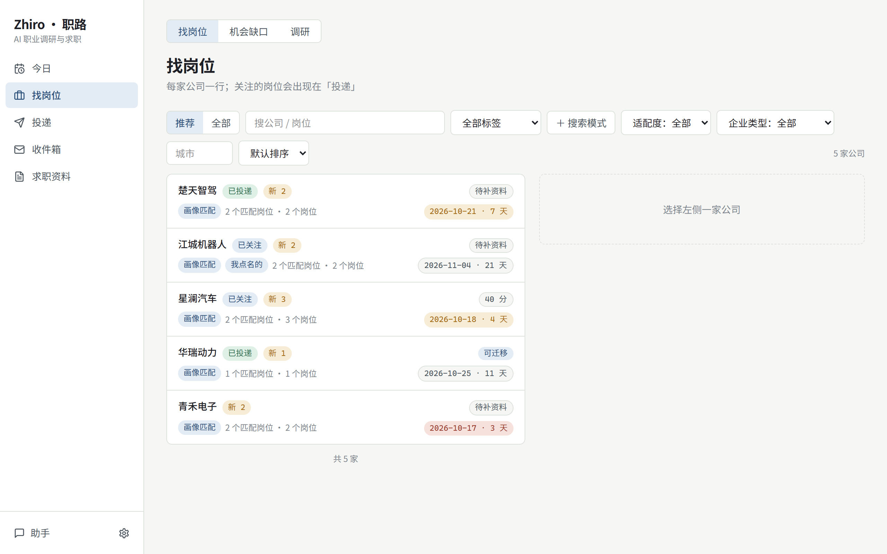

<div align="center">

# Zhiro · 职路

**本地优先的 AI 职业调研与求职工具——用你已经在用的 agent。**

[English](README.md) | 简体中文

[](https://github.com/mazjq/zhiro/actions/workflows/ci.yml)
[](https://www.npmjs.com/package/zhiro)
[](LICENSE)

</div>

职路把整个求职过程放在你自己的电脑上：哪些公司在招、哪些适合你、这周什么截止、每份申请走到哪一步。你自己的 AI agent（Claude Code、Codex、WorkBuddy，或任何支持 MCP 的客户端）可以帮你调研行业和公司、盯进度、填网申——**但提交按钮永远由你来点**。先为国内校招做，社招也能用。



## 能做什么

- **一个岗位库，每天自动更新。** 读公司自己的招聘站（Moka、北森、飞书招聘、大易、前程无忧、智联校园、国聘等）和你自己的表格（飞书多维表格、CSV 链接或文件）。多个来源的截止日期会对照合并，每条都标明出处。
- **哪些适合你。** 画像是一张张能核对的小卡片（教育、技能、项目、偏好）；岗位按它匹配，差距会变成「往哪补」，而不是悄悄筛掉。
- **今日。** 14 天内截止的、有变化的、等你拍板的几件事。
- **投递进度。** 关注 → 准备申请 → 已投递 → 笔试面试 → 结果，带提醒；收件箱把招聘邮件变成建议，由你确认。
- **网申填到提交前。** 用一个单独的 Chrome 档案，按你的画像和合适的那份简历填表；停在「提交」前，由你自己点。
- **用你自己的 agent 做调研。** 问一个行业或一家公司：你的 agent 上网查，再通过职路的工具拿财报、行业研报等数据，报告和你岗位库里的岗位对上号。
- **你的 agent，你定规矩。** 能撤销的事它直接做、你能撤销；有影响的事变成确认卡等你点；登录和凭据 agent 碰不到。
- **数据在你手里。** 全部在你电脑上的一个文件夹里。升级在副本上做、核对全对才换上；一条命令检查，一条命令回退。

## 安装

**装了 Node 22.13 或更新？**

```bash
npx zhiro                 # 试一下
npm i -g zhiro && zhiro   # 长期用
```

**没有 Node？** 一行命令，自带它需要的一切（自带一份官方 Node，按 nodejs.org 的校验和核对过；不动你系统里的东西）：

```powershell
# Windows（PowerShell）
irm https://github.com/mazjq/zhiro/releases/latest/download/install.ps1 | iex
```

```bash
# macOS / Linux
curl -fsSL https://github.com/mazjq/zhiro/releases/latest/download/install.sh | sh
```

<details><summary>想先看看脚本再运行？</summary>

下载 [`install.ps1`](https://github.com/mazjq/zhiro/releases/latest/download/install.ps1) 或 [`install.sh`](https://github.com/mazjq/zhiro/releases/latest/download/install.sh)，看过再运行。再运行一次就是升级，上一个版本会保留。
</details>

**想改代码？** 见 [CONTRIBUTING.md](CONTRIBUTING.md)：`git clone`、`pnpm install`、`pnpm dev`。

第一次启动会问数据放哪（直接回车用默认位置），然后在浏览器里打开。

### 让你的 agent 帮你装

把这句话贴给 Claude Code、Codex 或任何编程 agent：

```text
按 https://raw.githubusercontent.com/mazjq/zhiro/main/llms-install.md 帮我安装 Zhiro（用 curl 取原文，不要用网页摘要）。
```

## 在你自己的 agent 里用

职路是一组 MCP 工具。启动职路后，给你的 agent 接一次：

<details><summary>Claude Code</summary>

```bash
claude mcp add zhiro -- zhiro mcp            # Windows：claude mcp add zhiro -- cmd /c zhiro mcp
```
或者在职路的 agent 工作目录（设置页里有位置）里打开 Claude Code，那里都配好了。[详细](docs/harness/claude-code.md)
</details>

<details><summary>Codex</summary>

```bash
codex mcp add zhiro -- zhiro mcp             # Windows：codex mcp add zhiro -- cmd /c zhiro mcp
```
[详细](docs/harness/codex.md)
</details>

<details><summary>WorkBuddy、Cursor 和其他 MCP 客户端</summary>

[WorkBuddy](docs/harness/workbuddy.md) · [任何 MCP 客户端](docs/harness/others.md)
</details>

然后直接说：「这周有什么截止的」「关注武汉的控制算法岗」「调研一下人形机器人行业」「给第一个岗位填网申」。

职路窗口里的聊天面板也可以选由谁来回答（Claude Code、Codex，或可选的内置助手）：[docs/harness/embedded.md](docs/harness/embedded.md)。

## 你的数据

一个文件夹，在你的电脑上：`%APPDATA%\Zhiro\data`（Windows）、`~/Library/Application Support/Zhiro`（macOS）、`~/.local/share/zhiro`（Linux），或者你选的位置。不上传任何东西；联网的只有你订阅的招聘站、你选的 agent 或模型。

```bash
zhiro vault verify      # 数据完整吗
zhiro vault backup      # 随时备份一次（带检查）
zhiro vault rollback    # 回到上次升级前
```

详细：[docs/data.md](docs/data.md) · 接你自己的表格：[docs/data-sources.md](docs/data-sources.md)

## 文档

| | |
|---|---|
| [docs/data.md](docs/data.md) | 数据在哪；备份、升级、回退、搬到别的盘 |
| [docs/data-sources.md](docs/data-sources.md) | 把你自己的表格（飞书多维表格、CSV）接成每天更新的岗位来源 |
| [docs/harness/](docs/harness/) | Claude Code、Codex、WorkBuddy、DeepSeek（dsh）、其他 MCP 客户端 |
| [docs/contrib/](docs/contrib/) | 架构与设计决定（给贡献者） |

## 参与

欢迎报 bug、推荐要支持的招聘站、提 PR，见 [CONTRIBUTING.md](CONTRIBUTING.md)。加一个招聘站 = 一个文件加一个测试（[怎么加](apps/daemon/src/data/readers/README.md)）。安全问题请私下报告（[SECURITY.md](SECURITY.md)）。

## 许可

[MIT](LICENSE)。Moka 读取器包含来自 [career-ops](https://github.com/career-ops-hq/career-ops) 的三个文件（MIT）。
