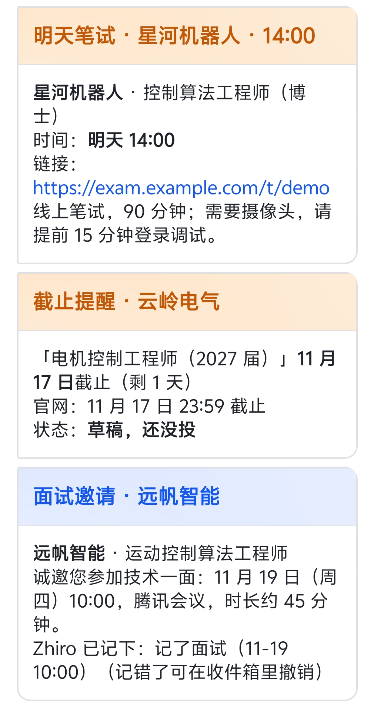

# 把提醒发到手机（飞书）

接上飞书以后，每天早上的简报、笔试和面试的时间、快截止的岗位、邮箱里收到的面试邀请，职路都会直接发到你手机上。消息你点开看了，才算通知到。

照下面两步做，大概花十分钟，只用做一次。



<sub>截图里的公司、岗位和时间都是虚构的。</sub>

## 会收到哪些消息

| 消息 | 什么时候发 | 没看的话 |
|---|---|---|
| 每日简报 | 每天早上（时间可在设置页改），讲从昨天到今天的新情况；周一附上本周短名单 | 只发一次 |
| 笔试、面试 | 前一天发一次，开始前两个半小时内再发一次 | 前一天那条两小时没看，用飞书「加急」再提醒；临近开始那条 15 分钟没看就加急，45 分钟还没看发短信 |
| 截止提醒 | 你关注的、或建了草稿还没投的岗位，截止前 14、7、3、1 天和截止当天 | 剩 1 天和当天的那两条，两小时没看加急一次 |
| 招聘邮件 | 从邮件里认出面试邀请、测评、录用或拒信时（需要先接入邮箱） | 录用和拒信两小时没看，加急一次 |

已经投了的岗位不会再收到截止提醒；笔试取消或改期，原来的提醒会自动作废。

## 第 1 步：在飞书开放平台建一个自己的应用

需要一个飞书账号，并且这个账号在某个团队里。只有个人账号的话，先在飞书里免费创建一个只有你自己的团队。

1. 打开 [open.feishu.cn/app](https://open.feishu.cn/app)，点「创建企业自建应用」。名字随意，比如「Zhiro 职路」。
2. 左边「添加应用能力」里，添加「机器人」。
3. 左边「权限管理」里，搜索并开通下面几项：

   | 权限名 | 用来做什么 |
   |---|---|
   | 以应用的身份发消息（`im:message:send_as_bot`） | 给你发消息 |
   | 通过手机号或邮箱获取用户 ID（`contact:user.id:readonly`） | 按你的手机号找到你 |
   | 获取单聊、群组消息（`im:message:readonly`） | 知道你有没有看过 |
   | 发送应用内加急消息（`im:message.urgent`） | 没看时加急提醒 |
   | 发送短信加急消息（可选） | 加急后仍没看时发短信 |
   | 发送电话加急消息（可选） | 打电话提醒，默认不用 |

4. 左边「版本管理与发布」里，创建一个版本，「可用范围」选你自己，然后发布。你是团队管理员的话，会直接通过。
5. 左边「凭证与基础信息」里，复制 **App ID**（`cli_` 开头）和 **App Secret**。

## 第 2 步：填进职路

打开职路的设置页，找到「飞书提醒」，点「接通飞书」，填三项：

- App ID
- App Secret
- 你登录飞书用的手机号或邮箱

点「接通并发测试」。手机飞书里会收到一条「Zhiro 已接通飞书」。你点开看过之后，设置页会显示「已在手机上看到」。

App Secret 只保存在你电脑上的职路数据文件夹里。

## 短信和电话

短信提醒默认开启，电话提醒默认关闭。两者用的都是你飞书团队的加急额度，额度由飞书定。

想改的话，编辑数据文件夹里的 `config/jobos.yaml`，加上或修改这一段，然后重启职路：

```yaml
notify:
  sms: false    # 不发短信
  phone: true   # 允许打电话（只在笔试、面试临近而前面的提醒都没看时）
```

## 没接通时会怎样

职路的「今日」页最上面会写明有几条提醒没送出去。接通之后，其中还没过时的会补发。

## 常见问题

| 看到的提示 | 原因和处理 |
|---|---|
| App ID 或 App Secret 不对 | 重新从「凭证与基础信息」复制，注意前后不要带空格 |
| 找人的权限还没生效 | 「通过手机号或邮箱获取用户 ID」没开通，或者开通后没有发布新版本 |
| 按这个手机号 / 邮箱没找到你 | 要填登录飞书用的那个；并确认应用的「可用范围」里有你 |
| 测试消息没发出去 | 「以应用的身份发消息」没开通，或者机器人能力加了以后没有发布新版本 |
| 设置页一直是「已发出，等你在手机上看一眼」 | 在手机飞书里点开那条消息；如果已经看过仍不变，检查「获取单聊、群组消息」权限 |
| 「今日」页说有提醒发送失败 | 多半是权限被改动或应用被停用，回开放平台检查后在设置页「重新接通」 |
